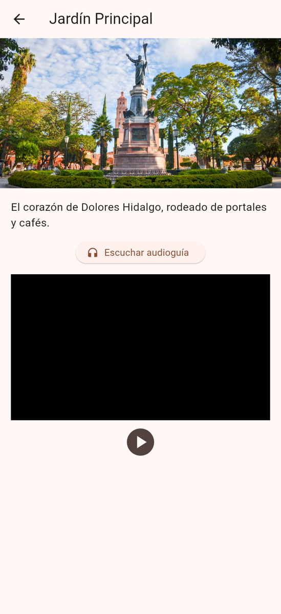
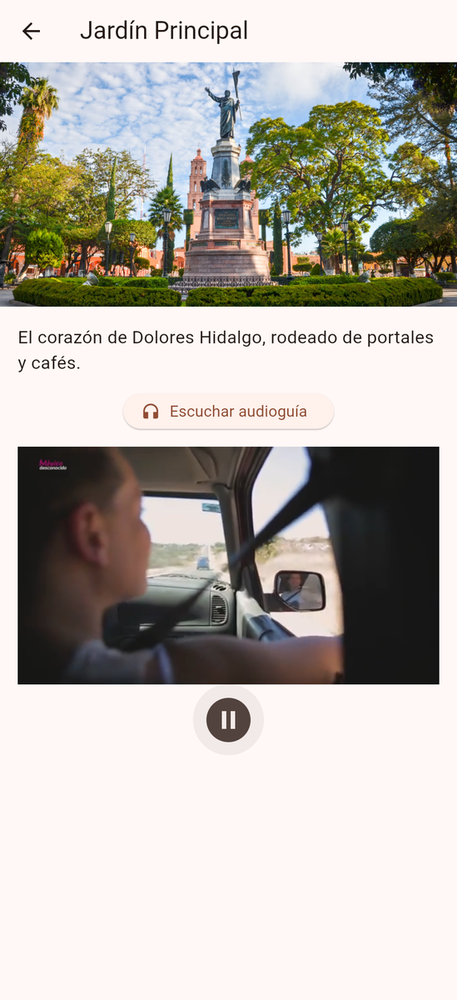

<<<<<<< HEAD
# Conoce-dolores
R1
=======
# Descubre Dolores Hidalgo

Guia turistica multimedia (imagen, audio-guia y video) construida con Clean Architecture en Flutter.






## Puesta en marcha

1. Dentro de esta carpeta, genera las carpetas de plataforma (android/, ios/, etc.) sin tocar `lib/`:

   ```
   flutter create . --project-name descubre_dolores
   ```

2. Coloca tus archivos multimedia (los nombres deben coincidir con `lugares_local_datasource.dart`):

   - `assets/images/`: `jardin_principal.jpg`, `parroquia.jpg`, `museo_hidalgo.jpg`
   - `assets/audio/`: `jardin_principal.mp3`, `parroquia.mp3`, `museo_hidalgo.mp3`
   - `assets/video/`: `jardin_principal.mp4`

   Si falta algun archivo, la app no se cae: muestra un icono en lugar de la imagen y omite el video.

3. Instala dependencias y ejecuta:

   ```
   flutter pub get
   flutter run
   flutter test
   ```

## Estructura

```
lib/
  domain/        entidades, interfaz del repositorio y casos de uso (Dart puro)
  data/          fuente de datos local e implementacion del repositorio
  presentation/  ViewModels y pantallas
  main.dart      composition root
```
>>>>>>> c185b69 (Descubre Dolores Hidalgo con Clean Architecture)
>>>>>>> 
